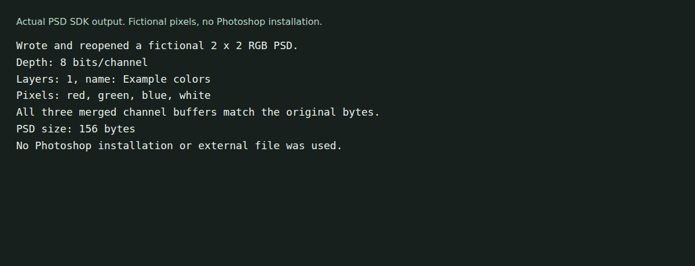

# psd_sdk

A Dart library for reading PSD metadata, layers and pixel channels, with limited PSD export. It is a port of the [Molecular Matters PSD SDK](https://github.com/MolecularMatters/psd_sdk), with that project's attribution preserved.



The example writes a 2 × 2 RGB document and checks the reopened channel bytes. This is library output, not a Photoshop screenshot. [Capture details](docs/demo/README.md).

## Run the example

The recorded checks used Dart 3.8.0 on Linux ARM64:

```sh
git clone https://github.com/olegpustovit/psd_sdk.git
cd psd_sdk
dart pub get
dart run example/round_trip.dart example-colors.psd
```

The program creates fictional red, green, blue and white pixels, writes one layer and a merged image, then reopens the file and checks its dimensions, layer name and composite channels. No Photoshop installation or external document is needed. The output path is optional and is overwritten by the example.

## Read an existing file

Use aliases to distinguish the SDK's memory wrapper from dart:io's file class:

```dart
import 'dart:io' as io;
import 'package:psd_sdk/psd_sdk.dart' as psd;

void inspect(String path) {
  final input = psd.File.fromByteData(io.File(path).readAsBytesSync());
  final document = psd.Document.fromFile(input);
  final section = document.parseLayerMaskSection(input);
  print('${document.width} x ${document.height}');
  for (final layer in section?.layers ?? <psd.Layer?>[]) {
    if (layer == null) continue;
    layer.extract(input);
    print(layer.name);
  }
}
```

The checked-in examples also contain TGA export helpers. They are separate from a claim that every PSD feature can be rendered or exported.

## Status and limits

The merged-image parser handles RAW and RLE. Layer handlers and compression enums cover other cases, but their existence is not complete PSD support. Smart-object records, masks, blend modes, color depths and compression combinations need feature-specific validation. The library does not establish Photoshop-equivalent compositing.

This cleanup fixed byte-view offsets and PSD byte-order handling for composite reads. Three regressions cover exported 8-, 16- and 32-bit composites read from a nonzero-offset input view. All 38 tests and static analysis passed. A self-round-trip is not independent Photoshop interoperability testing.

These source changes are not a published package release. Do not assume an installed package version includes them. Although the manifest retains a Dart 2.17 language level, archive 4.x requires Dart 3 or newer. Development checks used Dart 3.8.0; use that version for reproduction.

```sh
dart test
dart analyze
```

See [example and test notes](docs/demo/README.md) for scope and commands. Issues belong in [this repository](https://github.com/olegpustovit/psd_sdk/issues).

## License

[BSD 2-Clause](LICENSE), retaining the copyrights of Oleg Pustovit and Molecular Matters. The former README badge incorrectly named BSD 3-Clause.
